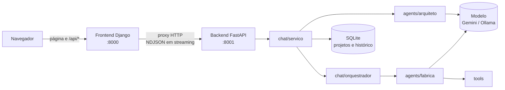
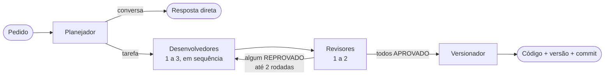

# Equipe de Software Multiagente

Sistema multiagente em Python com **LangChain**: você cria um projeto com assunto e descrição, a **IA monta uma equipe de agentes sob medida** (de 4 a 7, com nomes, responsabilidades e instruções específicas) e sugere ideias para começar. Depois, a equipe planeja, codifica, revisa e versiona cada pedido no chat. Cada projeto tem o próprio histórico, código e versão. O backend é uma API **FastAPI** com SQLite, e o frontend é um app **Django** com chat em tempo real.

## Arquitetura



O navegador só conversa com o Django. O Django repassa as chamadas ao backend e transmite cada etapa da equipe assim que ela termina.

### Criação do projeto

1. O usuário informa **assunto** e **descrição**.
2. O **arquiteto** (um agente com saída estruturada) projeta a equipe: nomes, etapa, responsabilidade e instruções de cada agente, mais de 3 a 5 ideias de primeiros pedidos.
3. A estrutura é garantida no código: **1** agente de planejamento, **1 a 3** de desenvolvimento, **1 a 2** de revisão e **1** de versionamento. Etapas faltando recebem o agente padrão, e se o arquiteto falhar (cota, rede) entra a equipe padrão (Paulo, Dora, Rui e Vera).
4. O chat abre mostrando quantos agentes foram criados e do que cada um cuida.

### Fluxo de cada pedido



| Etapa | Regras fixas (independem do prompt gerado) | Ferramenta |
|---|---|---|
| **Planejamento** | Separa conversa de pedido de código e quebra a tarefa em passos | — |
| **Desenvolvimento** | Cada desenvolvedor recebe o código do anterior e devolve o projeto completo | — |
| **Revisão** | Responde APROVADO ou REPROVADO; todos precisam aprovar | `verificar_sintaxe` (análise com `ast`, sem executar) |
| **Versionamento** | Propõe a versão semântica e a mensagem de commit | `proxima_versao` (major/minor/patch) |

A IA escreve a personalidade e a especialidade de cada agente; as regras de cada etapa ficam no código, então um prompt gerado ruim não quebra o fluxo. Sintaxe e número de versão são decididos por ferramentas determinísticas, e a aprovação final exige que o código passe no `ast`. O código gerado **nunca é executado**.

Cada projeto guarda a versão, o código atual e os últimos pedidos. Por isso pedidos como *"agora adicione validação nessa função"* funcionam, e cada projeto versiona separado dos outros.

### Fluxo ao vivo (estilo n8n)

Ao lado do chat fica o painel **Fluxo**, que mostra cada pedido como um grafo de nós:
Pedido → Planejador → rodada (desenvolvedores → revisores → decisão) → Versionador → Resultado.

- Os nós mudam de estado em tempo real: aguardando, executando (com cronômetro), concluído, reprovado ou pulado. Uma rodada reprovada cria a linha da rodada seguinte, mostrando o laço de correção.
- Clicar num nó abre o **inspetor**: o prompt exato que o agente recebeu, a saída, as ferramentas chamadas (argumentos → resultado), a duração e os tokens. Nos desenvolvedores aparece o **diff do código** (linhas adicionadas e removidas); na decisão, o resultado do `ast` e o voto de cada revisor.
- "Seguir ao vivo" mantém o inspetor no nó em execução.
- Cada pedido do histórico tem o botão **Ver fluxo**, que remonta a execução a partir dos eventos salvos.

O backend emite um evento `inicio` (com a entrada) e um `etapa` (com saída, duração, tokens e ferramentas) para cada nó, com ids estáveis (`plano`, `r1-dev-0`, `r1-rev-0`, `r1-decisao`, `versao`, `resultado`).

## Estrutura

```
backend/
  config.py            variáveis de ambiente, limites e escolha do modelo
  tools/               ferramentas determinísticas (sintaxe, versão)
  agents/
    arquiteto.py       a IA projeta a equipe; normalização e equipe padrão
    fabrica.py         regras fixas por etapa e criação dos agentes LangChain
    base.py            invocação e extração de código
  chat/
    projeto.py         estado do projeto (versão, código, pedidos recentes)
    repositorio.py     persistência em SQLite (projetos, agentes, histórico)
    orquestrador.py    fluxo da equipe por pedido
    servico.py         casos de uso: criar projeto e conversar
  api/app.py           API FastAPI (projetos e chat em streaming)
  cli.py               chat no terminal
  __main__.py          sobe o backend: python -m backend
  tests/               testes do backend (com agentes falsos)
frontend/
  manage.py
  config/              settings, urls e wsgi do Django
  chat/                app Django: views (proxy), template, CSS, app.js (chat) e fluxo.js (painel de fluxo)
Modulo_4_atividade_1.ipynb   atividade original (pedido P001 com três agentes)
```

## Instalação

Requer Python 3.12.

```bash
python -m venv .venv
# Windows
.venv\Scripts\activate
# Linux/macOS
source .venv/bin/activate

pip install -r requirements.txt
cp .env.example .env   # no Windows: copy .env.example .env
```

No `.env`, gere a chave do Django e cole em `DJANGO_SECRET_KEY`:

```bash
python -c "from django.core.management.utils import get_random_secret_key as g; print(g())"
```

## Escolha do modelo

O modelo é escolhido pelo que estiver no `.env`, nesta ordem:

| Variável | Modelo | Custo |
|---|---|---|
| `GOOGLE_API_KEY` | `gemini-3.5-flash-lite` | Plano gratuito do [Google AI Studio](https://aistudio.google.com/apikey), com limite de uso |
| `OLLAMA_API_KEY` | `gemma4:31b` no Ollama Cloud | Exige créditos |
| nenhuma | `qwen2.5:7b` no [Ollama](https://ollama.com) local | Gratuito; rode antes `ollama pull qwen2.5:7b` |

## Uso

Em dois terminais, com o ambiente virtual ativo:

```bash
# Terminal 1 — backend (http://127.0.0.1:8001)
python -m backend

# Terminal 2 — frontend (http://127.0.0.1:8000)
cd frontend
python manage.py runserver
```

Acesse **http://127.0.0.1:8000**, clique em **Novo projeto**, informe assunto e descrição (por exemplo, *"Biblioteca escolar: cadastro de livros e alunos, empréstimos de 7 dias e multa por atraso"*) e use as ideias sugeridas ou peça o que quiser. Os projetos ficam no histórico da lateral, salvos em `data/equipe.db`.

**Chat no terminal**, sem frontend:

```bash
python -m backend.cli
```

**Notebook**: abra `Modulo_4_atividade_1.ipynb` com o kernel do `.venv` e execute do início.

### API do backend

| Método | Rota | Descrição |
|---|---|---|
| `GET` | `/api/saude` | Status e modelo em uso |
| `GET` | `/api/projetos` | Histórico: projetos com versão e número de agentes |
| `POST` | `/api/projetos` | `{"titulo": "...", "descricao": "..."}` → projeto com equipe projetada pela IA |
| `GET` | `/api/projetos/{id}` | Projeto, agentes e histórico completo de mensagens |
| `DELETE` | `/api/projetos/{id}` | Exclui o projeto e o histórico |
| `POST` | `/api/projetos/{id}/chat` | `{"mensagem": "..."}` → eventos NDJSON em tempo real |

Documentação interativa em http://127.0.0.1:8001/docs.

## Testes

Os testes usam agentes e backend falsos, então não gastam cota da API.

```bash
python -m unittest discover -s backend/tests -t .
cd frontend && python manage.py test chat
```

## Robustez

- Projetos, agentes e histórico persistidos em SQLite: reiniciar o servidor não apaga nada.
- Equipe gerada pela IA sempre normalizada (limites por etapa, nomes únicos, textos cortados), com equipe padrão se o arquiteto falhar.
- Entradas validadas: título até 80, descrição até 1500 e mensagem até 2000 caracteres; ids só hexadecimais de 32 caracteres.
- Erros do modelo (cota 429, chave inválida, Ollama fora do ar) viram mensagens claras na tela e ficam no histórico, sem derrubar o servidor nem alterar a versão.
- Um projeto processa um pedido por vez (HTTP 409 se chegar outro ou se tentar excluí-lo); projetos diferentes rodam em paralelo.
- Respostas cortadas pelo limite de tokens são detectadas (o código não passa no `ast`) e voltam para correção.
- Timeout e novas tentativas nas chamadas ao modelo.
- Proteção CSRF no Django e todo texto do modelo exibido como texto, nunca como HTML.

## Deploy do frontend

Com `DJANGO_DEBUG=false` o Django exige `DJANGO_SECRET_KEY`, ativa HTTPS obrigatório, cookies seguros e HSTS, e os arquivos estáticos passam a ser servidos pelo WhiteNoise com cache longo.

```bash
cd frontend
python manage.py check --deploy
python manage.py collectstatic --noinput
```

Configure `DJANGO_ALLOWED_HOSTS`, `DJANGO_CSRF_TRUSTED_ORIGINS` e `BACKEND_URL` com os endereços reais, e rode o Django com um servidor WSGI de produção (por exemplo, gunicorn: `gunicorn config.wsgi`) atrás de um proxy HTTPS.

## Limitações

- Equipes maiores fazem mais chamadas ao modelo por pedido (de 6 a 15); no plano gratuito do Gemini isso pode atingir o limite por minuto.
- O código do projeto é um único arquivo Python que cresce a cada pedido; projetos muito grandes podem passar do limite de tokens (`MAX_TOKENS`).
- O código gerado é exibido, mas não é salvo em arquivo nem executado; a conferência garante sintaxe válida, não lógica correta.
- As respostas dos modelos variam entre execuções, e modelos menores (como o `qwen2.5:7b`) erram com mais frequência.

## Licença

[MIT](LICENSE)
